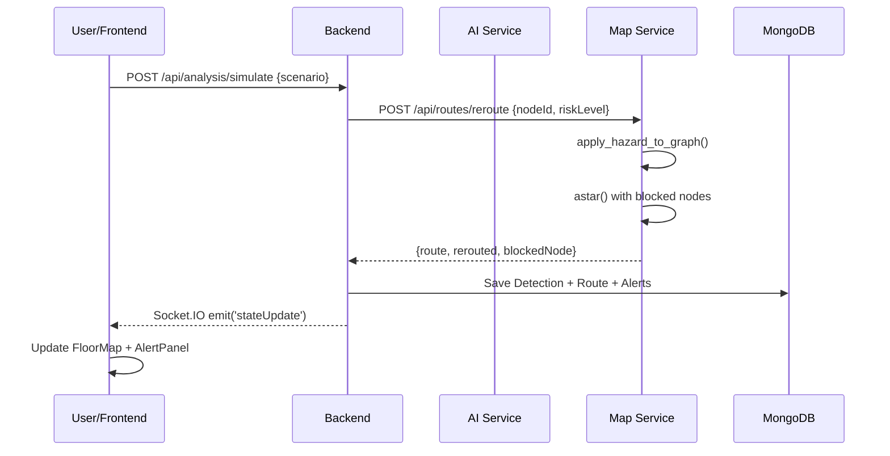
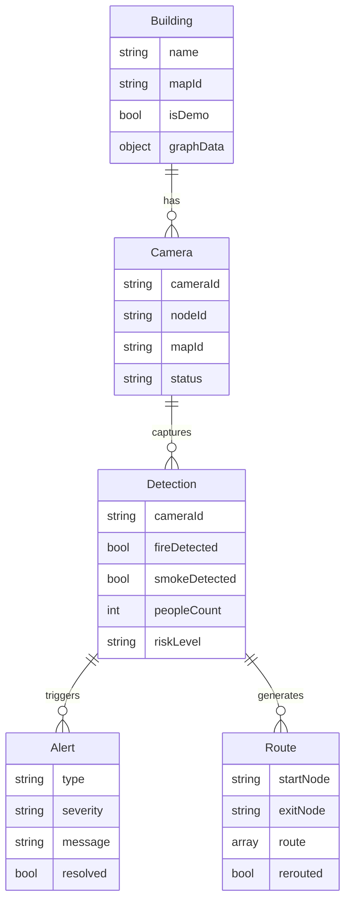

# Evac-AI Architecture

## System Overview

```
┌─────────────────────────────────────────────────────────────────┐
│                         EVAC-AI SYSTEM                          │
├──────────────┬──────────────────┬──────────────┬───────────────┤
│  ai-service  │   map-service    │   backend    │   frontend    │
│  :8000       │   :8001          │   :3001      │   :5173       │
│              │                  │              │               │
│ WHAT is      │ WHERE is it      │ HOW are      │ HOW does the  │
│ happening?   │ happening?       │ services     │ user see it?  │
│              │ Where to go?     │ connected?   │               │
└──────────────┴──────────────────┴──────────────┴───────────────┘
```

## Data Flow

```
CAD/DXF File
     │
     ▼
map-service/parsers/dxf_parser.py
     │  (entities: walls, rooms, doors, exits)
     ▼
map-service/graph/builder.py
     │  (nodes: room/corridor/exit, edges: connections)
     ▼
map-service/routing/astar.py
     │  (initial evacuation route)
     ▼
backend (stores in MongoDB)
     │
     ▼
frontend (renders SVG floor map + route)

         ┌──────────────────────────────┐
         │  CCTV Image / Video Frame    │
         └──────────────┬───────────────┘
                        │
                        ▼
              ai-service/detectors/
              person_detector.py  ──► peopleCount
              fire_smoke_detector.py ► fireDetected, smokeDetected
                        │
                        ▼
              ai-service/analysis/
              density.py  ──► densityLevel
              risk.py     ──► riskScore, riskLevel
                        │
                        ▼
              backend/analysis.controller.js
                        │
              camera → nodeId mapping
                        │
                        ▼
              map-service/routing/hazard_mapper.py
              (node.blocked = true, edge.cost = ∞)
                        │
                        ▼
              map-service/routing/astar.py
              (recalculate with blocked nodes/edges)
                        │
                        ▼
              backend → Socket.IO broadcast
                        │
                        ▼
              frontend (new route + alert displayed)
```

## A* Algorithm

```
f(n) = g(n) + h(n)

g(n) = accumulated edge cost from start node
       (cost = distance × risk_multiplier)

h(n) = Euclidean distance to goal exit (admissible heuristic)

Risk multipliers (configurable):
  normal   → 1.0×
  moderate → 2.0×
  high     → 5.0×
  critical → ∞ (blocked)
```

## Mermaid: Sequence Diagram



## Mermaid: ER Diagram


